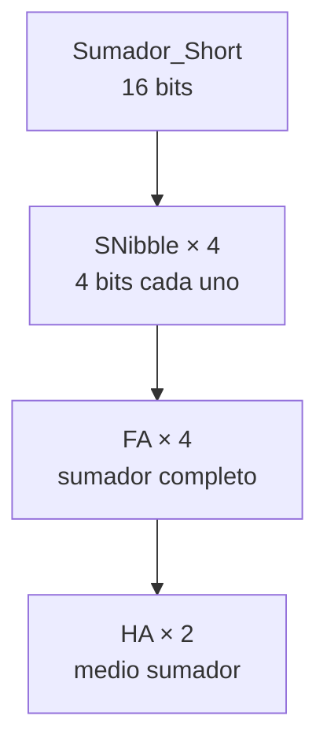
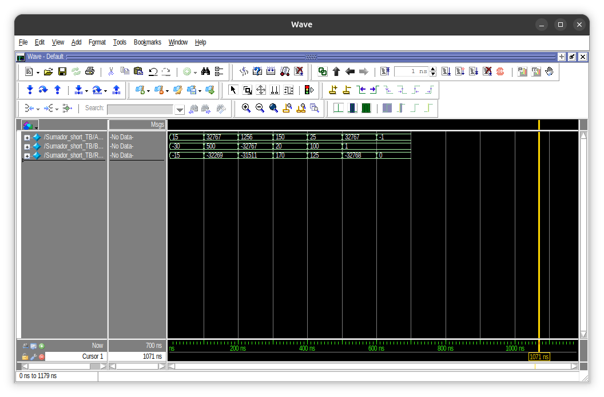

# 01 · Sumador de 16 bits

Sumador de 16 bits construido por niveles: un medio sumador, un sumador completo hecho con dos medios sumadores, un sumador de 4 bits (nibble) y cuatro nibbles encadenados por el acarreo.

## Jerarquía

| Archivo | Contenido |
|---|---|
| `HA.v` | Medio sumador: suma dos bits y saca suma y acarreo |
| `FA.v` | Sumador completo: dos medios sumadores más el acarreo de entrada |
| `SNibble.v` | Sumador de 4 bits con 4 FA en cascada. Entradas `AA`, `BB`, `Cin`; salida `Res` de 5 bits, donde `Res[4]` es el acarreo |
| `Sumador_short.v` | Sumador de 16 bits con 4 `SNibble`. Entradas `AAA`, `BBB`; salida `RR` de 16 bits |
| `Sumador_short_TB.v` | Testbench |

## Resultados

<!-- Verifica que estos casos coincidan con tu testbench y tu captura. Si cambiaste alguno, corrige la tabla. -->

| AAA | BBB | RR | Nota |
|---|---|---|---|
| 15 | −30 | −15 | Resta con complemento a 2 |
| 32767 | 500 | -32269 | Desbordamiento: el resultado real (33267) no cabe |
| 1256 | −32767 | −31511 | Resta con complemento a 2 |
| 150 | 20 | 170 | |
| 25 | 100 | 125 | |
| 32767 | 1 | -32768 | Desbordamiento: el máximo positivo más 1 da la vuelta al mínimo negativo |
| −1 | 1 | 0 | Hay acarreo final, pero el resultado con signo es correcto |

## Lo que aprendí

- **El acarreo se propaga.** Cada nibble espera el acarreo del anterior (*ripple carry*), así que el retardo crece con el número de bits.
- **Las restas salen gratis con complemento a 2.** El circuito solo suma; al meter `−30` desde el testbench, Verilog lo convierte a complemento a 2 y la suma da el resultado correcto.
- **Verilog distingue mayúsculas.** `Sumador_Short` y `Sumador_short` son módulos distintos para el simulador.
- **`` `timescale ``.** Sin esa línea al inicio del archivo, ModelSim simula en picosegundos y los retardos no cuadran.

## Limitaciones

- No tiene una entrada de control para restar. Para hacerlo en hardware habría que invertir `BBB` con XOR y poner `Cin = 1` en el primer nibble.
- No tiene bandera de desbordamiento. Se podría agregar comparando los bits de signo: si AAA[15] y BBB[15] son iguales y RR[15] es distinto, hubo desbordamiento.
