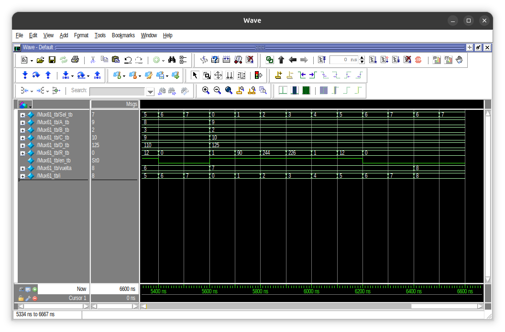

# 02 · Multiplexor 6 a 1

Multiplexor que elige entre seis operaciones aritméticas y lógicas. Cada operación está en su propio módulo, y `Mux61` las instancia y selecciona una con `case`.

## Entradas y salidas

| Señal | Ancho | Función |
|---|---|---|
| `A`, `B`, `C` | 4 bits | Operandos |
| `D` | 8 bits | Operando |
| `Sel` | 3 bits | Elige la operación |
| `R` | 8 bits | Resultado |
| `en` | 1 bit | Vale `1` en las operaciones marcadas |

`Sel` es de 3 bits porque 2 bits solo dan 4 combinaciones y se necesitan 6.

## Operaciones

| `Sel` | Archivo | Operación | `en` |
|---|---|---|---|
| 0 | `Op.v` | A + B − C | 1 |
| 1 | `Op2.v` | A × C | 0 |
| 2 | `Op3.v` | D << 2 | 1 |
| 3 | `Op4.v` | C × D | 0 |
| 4 | `Op5.v` | D mod 2 | 0 |
| 5 | `Op6.v` | B + C | 1 |
| 6, 7 | — | Sin operación: `R = 0` | 0 |

## Resultados

Una de las vueltas del testbench, con A = 9, B = 2, C = 10 y D = 125:

| `Sel` | Operación | R | `en` |
|---|---|---|---|
| 0 | 9 + 2 − 10 | 1 | 1 |
| 1 | 9 × 10 | 90 | 0 |
| 2 | 125 << 2 | 244 | 1 |
| 3 | 10 × 125 | 226 | 0 |
| 4 | 125 mod 2 | 1 | 0 |
| 5 | 2 + 10 | 12 | 1 |
| 6 | — | 0 | 0 |
| 7 | — | 0 | 0 |

## Lo que aprendí

- **El ancho de la salida importa.** `R` es de 8 bits, así que `125 << 2` (500) y `10 × 125` (1250) se desbordan y quedan en 244 y 226.
- **El `default` del `case`** cubre los códigos 6 y 7, que no tienen operación, y evita salidas indefinidas.
- **Verilog distingue mayúsculas.** Instanciar `MUX61` cuando el módulo se llama `Mux61` falla al cargar la simulación.

## Limitaciones

- Es combinacional: no guarda nada entre operaciones.
- No tiene banderas de acarreo ni de desbordamiento.
