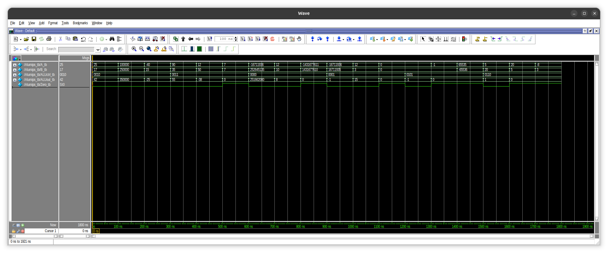

# 03 · ALU MIPS de 32 bits

ALU de 32 bits basada en la del procesador MIPS (Patterson y Hennessy). Hace seis operaciones y saca la bandera `Zero`, que en un MIPS real sirve para las instrucciones de salto `beq` y `bne`.

## Operaciones

| `ALUctrl` | Operación |
|---|---|
| `0000` | AND |
| `0001` | OR |
| `0010` | Suma |
| `0011` | Resta |
| `0101` | NOR |
| `0110` | SLT (A < B) |

`Zero` vale `1` cuando el resultado es cero.

## Resultados

El testbench prueba cada operación con tres casos: valores normales, negativos y resultados en cero. Algunos ejemplos:

| Operación | A | B | Resultado | Zero |
|---|---|---|---|---|
| Suma | 25 | 17 | 42 | 0 |
| Suma | −40 | 15 | −25 | 0 |
| Resta | 12 | 50 | −38 | 0 |
| Resta | 7 | 7 | 0 | 1 |
| AND | 12 | 10 | 8 | 0 |
| OR | 12 | 3 | 15 | 0 |
| NOR | 0 | 0 | −1 (`FFFFFFFF`) | 0 |
| SLT | 5 | 20 | 1 | 0 |
| SLT | −8 | 3 | 0 | 1 |

## Lo que aprendí

- **SLT sin signo da resultados raros.** Con A = −8 y B = 3 esperaba 1, pero dio 0: sin signo, −8 en 32 bits es un número enorme. En [RARO SUPREME](https://github.com/LeoCamposSec/raro-supreme-verilog) lo corregí con `$signed()`.
- **Asignación bloqueante (`=`) contra no bloqueante (`<=`).** En lógica combinacional, dentro de `always @(*)`, va `=`. La no bloqueante es para bloques con reloj.
- **Radix en ModelSim.** Para leer sumas y restas hay que cambiar las señales a decimal; en binario o hexadecimal no se entienden a simple vista.

## Limitaciones

- SLT compara sin signo, así que falla con números negativos.
- No tiene banderas de acarreo ni de desbordamiento.
